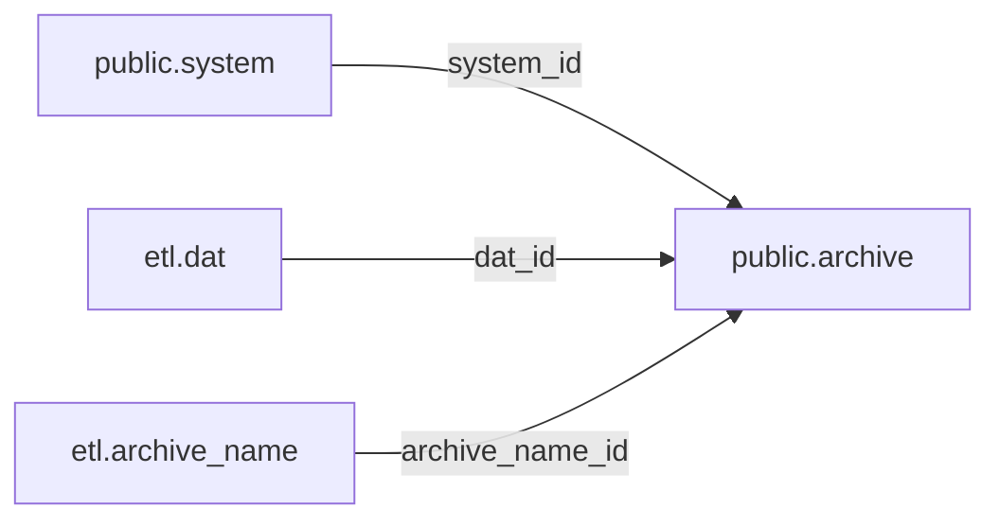

# Database model

## Schema boundaries

| Schema | Ownership and contents |
| --- | --- |
| `staging` | Raw external exports: `rv_files` |
| `ref` | Reserved for manually maintained reference tables, normally loaded from static files |
| `etl` | Imported source identities, generated mapping results, filename parses and transforms |
| `public` | Persistent catalogue entities, starting with systems and archives |

Migration 004 introduced the stable IDs. Migration 005 moves the source and
transform objects from `ref` to `etl`, preserving the existing objects and data.
`etl.schema_migration` records both upgrades. The [SQL index](../sql/README.md)
describes their prerequisites and ordering.

`ref` is currently empty. The [canonical CSV](../data/reference/canonical_systems.csv)
was the initial seed for `public.system`; edits to that file are not loaded by
`sync`. Reference-file loading will need an explicit policy for preserving IDs.

## Current entities

| Table | Identity and purpose |
| --- | --- |
| `public.system` | `id`; canonical manufacturer and system display names |
| `public.archive` | `id`; source ZIP, with `system_id`, `dat_id`, `archive_name_id` |
| `etl.dat` | `id`; DAT path/name, source labels and default `system_id` |
| `etl.archive_name` | `id`; original ZIP name and its derived title/tag parse |
| `etl.system_mapping` | Source manufacturer/system alias pair mapped to `system_id` |

`ref.canonical_system` was moved to `public.system`, preserving the full canonical
list. Canonical names are no longer stored as foreign keys in `system_mapping`.
The display fields in `etl.v_romset_system` and `etl.v_archive` are resolved through
the system ID, so a rename is visible without rewriting archive relationships.



An archive currently identifies a ZIP name within a source DAT. Identical names
in different DATs remain different archive records; they can share a parsed-name
ID within one collection. Name changes in canonical systems and parser output
do not affect either ID. IDs are generated keys, not contiguous counters.

Source labels still serve as lookup keys at the import boundary. A DAT is
discovered by `(dat_path, dat_name)` and a source spelling by `(romset,
archive_name)`. Renaming/versioning a source DAT path/name or ZIP name creates a
new source identity; automatically reconciling those changes is future work.
Internal archive joins and future title/release/file relationships use IDs.

The `etl` schema contains persistent state as well as recomputable fields.
DAT/name IDs are referenced by core archives, and `etl.system_mapping` contains
reviewed alias/manual decisions alongside discovered matches. Preserve these
records; only the parsed metadata is freely recomputable. A later split can put
maintained alias rules into `ref` while keeping discovery results in `etl`.

## Refresh behavior

```sh
python -m gamedb sync
```

The CLI loads connection settings from the repository's ignored `.env` file
(`PGHOST`, `PGPORT`, `PGUSER`, `PGDATABASE`, `PGPASSWORD`). Exported settings take
precedence; `.pgpass` can supply the password when `PGPASSWORD` is omitted.
Both the local CLI and Compose use this external database. The CLI performs:

1. Discover source system aliases, preserving resolved and manual mappings.
2. Upsert source DATs and archive records while preserving existing IDs.
3. Register new archive names as `pending`, then parse them by their IDs.

The individual database refresh is available as:

```sql
SELECT etl.refresh_system_mapping();
SELECT * FROM etl.refresh_archives();
```

Call the archive refresh after staging or system mapping changes. The archive
view now reads persisted identities instead of grouping the full staging table
on every query. Name parses remain refreshable derived data. A parser rerun
updates metadata only, preserving the name ID and every archive reference.

Archives missing from the current staging contents retain their IDs with
`is_present = false` and `staged_row_count = 0`. If the same source archive returns,
its record is reactivated. `etl.v_archive` exposes current archives only; query
`public.archive` directly when historical source records matter.

`staged_row_count` counts source export rows, including repeated exports; it is
not a deduplicated count of file contents. Blank/missing archive names cannot
define an archive and are skipped by synchronization. All current supported
source rows have names and system mappings.

## System assignments and overrides

By default, an archive inherits its DAT's `system_id`, with
`system_assignment = 'dat'`. Unresolved DATs can create archives with a null
system ID; a later mapping and refresh resolves them.

To deliberately override one archive, use its IDs and mark the choice manual.
The following uses psql variables for IDs selected by the reviewer:

```sql
UPDATE public.archive
SET system_id = :chosen_system_id, system_assignment = 'manual'
WHERE id = :archive_id;
```

Future source refreshes preserve this assignment. Set `system_assignment` back
to `dat` and refresh to resume inheritance. This supports the future Redump FXGA
exceptions; no release-name override rules have been applied automatically.

## Inspection

```sql
SELECT id, manufacturer_name, name FROM public.system ORDER BY manufacturer_name, name;

SELECT a.id AS archive_id, a.system_id, s.manufacturer_name, s.name AS system_name,
       a.dat_id, a.archive_name_id, p.archive_name, p.title_candidate, p.tags
FROM public.archive a
LEFT JOIN public.system s ON s.id = a.system_id
JOIN etl.archive_name p ON p.id = a.archive_name_id
WHERE a.is_present;

SELECT archive_id, system_id, dat_id, archive_name_id, title_candidate, parse_issues
FROM etl.v_archive
WHERE parse_status = 'review';
```

The target hierarchy is **System → Title → Release → File**. Systems and source
archives are established now. Canonical titles, release reconciliation and file
identities will be introduced in later waves, using these IDs. A candidate title
or ZIP is not automatically promoted to a canonical title or release.
